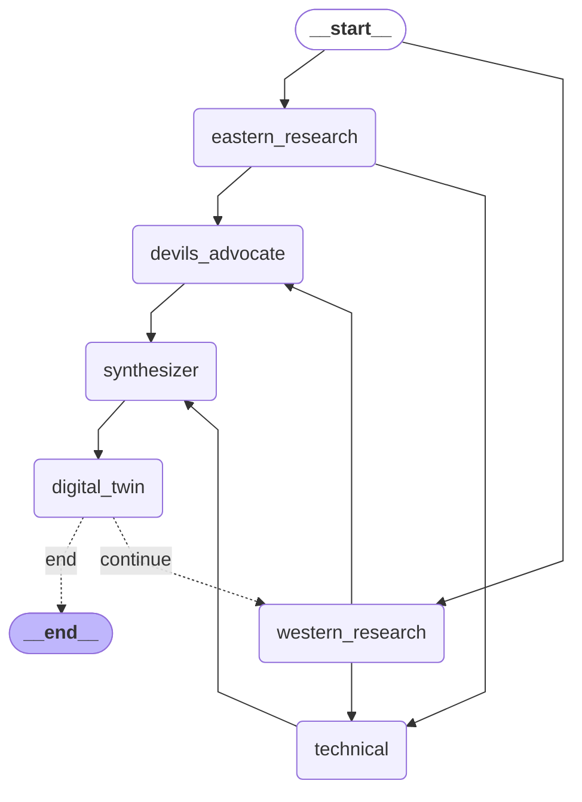

# Graph Visualization

This document provides a visualization of the LangGraph workflow used in this project.

## Mermaid Diagram

## Workflow Explanation

1.  **Parallel Research Entry**: The system starts by concurrently launching `western_research` and `eastern_research` to gather global perspectives.
2.  **Deep Analysis**: After both research nodes complete, the data flows into `technical` (for implementation details) and `devils_advocate` (for critical scrutiny).
3.  **Synthesis**: The `synthesizer` merges the research and analysis into a cohesive response.
4.  **Final Verdict (Digital Twin)**: The `digital_twin` agent reviews the output.
5.  **Iteration Loop**: 
    - If the Digital Twin is **satisfied**, the process terminates (`__end__`).
    - If **unsatisfied**, it loops back to the start (`western_research`) for refinement, incrementing the rejection count.

## Configuration Limits
- **Max Rejections**: Governed by `MAX_REJECTIONS` in `src/config.py`.
